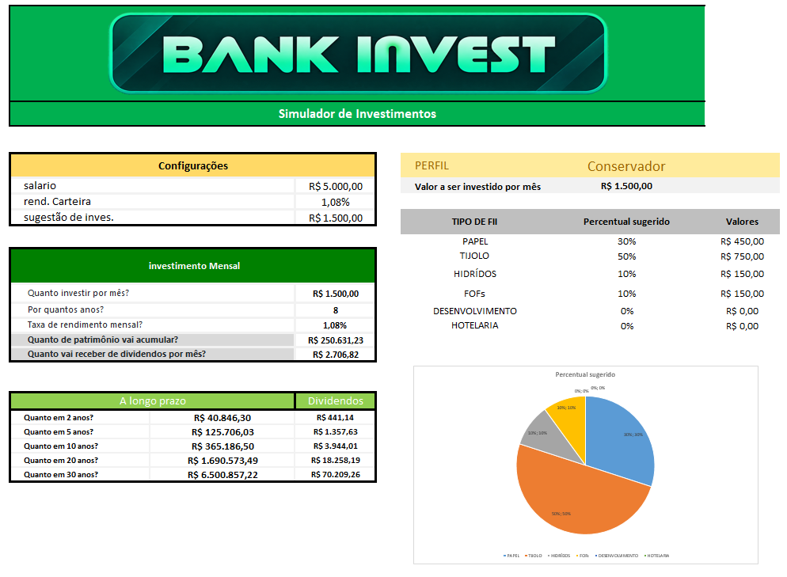
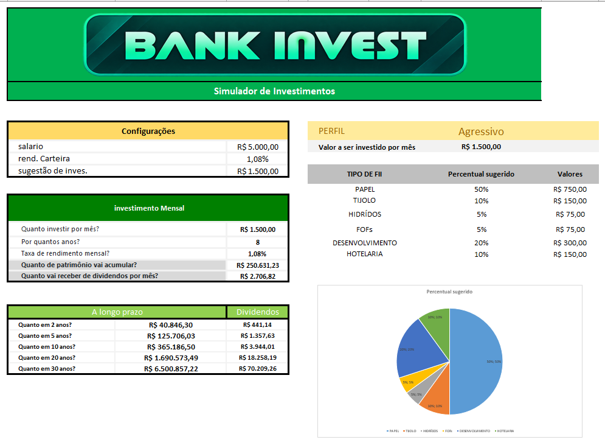

# 🏦 BANK INVEST

### Simulador de Investimentos em Fundos Imobiliários no Excel

Uma ferramenta interativa para explorar aportes mensais, projeções de patrimônio, dividendos estimados e a distribuição de investimentos por perfil.


**Tecnologias:** Microsoft Excel · Fórmulas financeiras · PROCV · Validação de Dados · Gráficos Dinâmicos

</div>

## 📌 Sobre o projeto

O **BANK INVEST** foi desenvolvido como projeto prático do desafio de simulação de investimentos em fundos imobiliários (FIIs) da **DIO**.

O objetivo é transformar uma planilha em uma interface intuitiva, permitindo que a pessoa altere os dados de entrada e veja os resultados calculados automaticamente, sem precisar conhecer as fórmulas do Excel.

> **Aviso:** ferramenta educativa. As taxas, salários e percentuais utilizados são **exemplos hipotéticos**, não previsões de retorno nem recomendações de investimento. Dividendos de FIIs são variáveis e não são garantidos.

## 🎯 Perguntas que a ferramenta responde

| Pergunta | Onde encontrar |
|---|---|
| Quanto investir por mês? | Campo **Investimento Mensal** |
| Por quantos anos investir? | Campo **Prazo (anos)** |
| Qual a taxa de rendimento mensal? | Campo **Taxa de rendimento mensal** |
| Quanto patrimônio poderá acumular? | Resultado **Patrimônio acumulado** |
| Quanto poderá receber em dividendos por mês? | Resultado **Dividendos mensais estimados** |

A ferramenta também apresenta projeções para **2, 5, 10, 20 e 30 anos**, uma sugestão didática de aporte de **30% do salário** e uma distribuição por tipo de FII de acordo com o perfil escolhido.

## 🖥️ Demonstração

### Perfil Conservador



### Perfil Agressivo



Os dois exemplos utilizam os mesmos dados de aporte, prazo e taxa. Somente o **perfil de investidor** muda, alterando a distribuição percentual e o gráfico de pizza automaticamente.

## ⚙️ Como funciona

### 1. Projeção com a função VF

O patrimônio futuro é estimado por meio da função **VF (Valor Futuro)** do Excel, considerando aportes mensais e capitalização composta. Em sua forma ilustrativa:

```excel
=VF(taxa_mensal;qtd_anos*12;-aporte;0;0)
```

- `taxa_mensal`: taxa hipotética por mês;
- `qtd_anos*12`: conversão do prazo em meses;
- `-aporte`: saída mensal de dinheiro para investimento;
- `0`: patrimônio inicial considerado nulo;
- `0`: aporte realizado ao fim de cada mês.

O valor dos dividendos mensais é uma **estimativa simplificada**, calculada ao multiplicar o patrimônio projetado por uma taxa mensal hipotética. Na vida real, o rendimento total da carteira e a distribuição de dividendos não são necessariamente iguais.

### 2. Perfis com PROCV e chave composta

A tabela auxiliar reúne **perfil**, **tipo de FII** e **percentual**. Uma chave composta, como `MODERADO-TIJOLO`, permite identificar uma combinação específica.

O **PROCV**, com correspondência exata (`FALSO`), procura essa chave e devolve o percentual da coluna correspondente. O aporte destinado a cada categoria é calculado por:

```excel
=aporte*percentual_da_categoria
```

A seleção do perfil é feita em uma **lista suspensa com Validação de Dados**, e o gráfico de pizza utiliza os percentuais calculados para se atualizar automaticamente.

### 3. Intervalos nomeados

Os intervalos nomeados criados no Excel são:

| Nome | Finalidade |
|---|---|
| `aporte` | Investimento mensal utilizado na projeção |
| `qtd_anos` | Prazo da simulação |
| `taxa_mensal` | Taxa mensal usada nos cálculos |
| `patrimonio` | Patrimônio acumulado calculado |
| `rend_carteira` | Parâmetro de rendimento da carteira |

## 📊 Percentuais por perfil

| Tipo de FII | Conservador | Moderado | Agressivo |
|---|---:|---:|---:|
| Papel | 30% | 32% | 50% |
| Tijolo | 50% | 40% | 10% |
| Híbridos | 10% | 8% | 5% |
| FOFs | 10% | 10% | 5% |
| Desenvolvimento | 0% | 5% | 20% |
| Hotelaria | 0% | 5% | 10% |
| **Total** | **100%** | **100%** | **100%** |

**Origem:** percentuais fictícios definidos para exercitar PROCV, validação de dados e gráficos. **Não representam uma indicação de alocação ou de risco real** para cada categoria.

## ✨ Evoluções em relação ao exercício-base

- Identidade visual personalizada **BANK INVEST**, com interface de dashboard;
- Projeções de dividendos ao lado das estimativas de patrimônio para diferentes horizontes;
- Integração entre sugestão de aporte baseada no salário, simulação principal e distribuição;
- Escolha do perfil por lista suspensa;
- Gráfico de pizza atualizado automaticamente conforme o perfil;
- Documentação e capturas de tela comparando perfis com a mesma simulação.

## 🚀 Como utilizar

1. Baixe o arquivo **[tabela investimentos.xlsx](tabela%20investimentos.xlsx)**.
2. Abra-o no **Microsoft Excel**.
3. Ajuste os valores de salário, aporte, prazo e taxa mensal.
4. Escolha o perfil **Conservador**, **Moderado** ou **Agressivo**.
5. Observe as projeções, a divisão do aporte e o gráfico dinâmico.

### Visualização online

**[🌐 Visualizar o BANK INVEST no Google Planilhas](https://docs.google.com/spreadsheets/d/194Y7By3aD96ZHMwfMUSL-rQg96h35vPNaXGdd98Gsj4/edit?usp=drivesdk)**

A versão online está compartilhada para leitura. Para alterar os valores ou experimentar os perfis sem modificar o original, crie uma cópia na sua conta Google (Arquivo → Fazer uma cópia), quando essa opção estiver disponível. Para a experiência original, baixe o arquivo Excel do repositório.

## 🧪 Exemplo de simulação

| Parâmetro | Valor ilustrativo |
|---|---:|
| Salário usado no exemplo | R$ 5.000,00 |
| Aporte mensal (30%) | R$ 1.500,00 |
| Prazo | 8 anos |
| Taxa mensal hipotética | 1,08% |
| Patrimônio projetado | R$ 250.631,23 |
| Dividendos mensais estimados ao final | R$ 2.706,82 |

**Observação:** projeção simplificada com taxa constante e reinvestimento hipotético; não considera impostos, taxas, inflação, oscilações de mercado ou variação dos dividendos.

## 👨‍💻 Autor

Desenvolvido por **Thiago Volpolini** como parte dos estudos em Excel, análise de dados e automação de cálculos financeiros.

[GitHub](https://github.com/thiagovolpolini-art) · [LinkedIn](https://www.linkedin.com/in/thiago-volpolini/)

